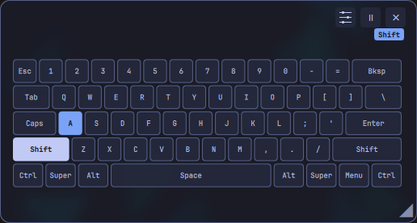

# Keycorner


A movable keyboard overlay for Omarchy. See pressed keys and held modifiers, keep a layout reference nearby, and pause input with a shortcut.



**v0.6.0 · x86_64 Omarchy · MIT desktop plugin**

## Features

- **A floating layout reference.** Move and resize the overlay, adjust transparency, lock its position or let clicks pass through it.
- **Standard keyboards.** Choose from 18 US ANSI, Brazilian ABNT2 and regional ISO presets. Save the selection per device.
- **Personal Vial layouts.** Discover compatible keyboards and read their layout and keymaps. No personal Vial layouts or saved devices ship with the plugin.
- **Live feedback.** Highlight keys and held modifiers; Vial mode also supports mouse-button output and optional modifier-hold coloring.
- **Layer visibility.** Preview Vial layers or follow exact live layers with the optional firmware extension. Firmware setup is separate.
- **Quick privacy controls.** Pause input while keeping the reference visible. Hiding, minimizing or screen locking also stops the reader.
- **Omarchy styling.** Overlay and settings follow the current theme. A bar button and configurable recorded shortcuts provide access.

[Feature tour and screenshots](docs/marketplace/FEATURES.md) · [Layout catalog](docs/STANDARD_LAYOUTS.md) · [Detailed user guide](docs/USER_GUIDE.md)

## Install and set up

Requires x86_64 Omarchy with its Quickshell/Hyprland shell, glibc 2.39+, libgcc_s and liblzma. The native runtime is bundled; Cargo, Python and Vial Desktop are not runtime requirements.

Install through Omarchy:

```sh
omarchy plugin add https://github.com/lbiasuz/keycorner --enable --yes
```

1. Open Keycorner Settings using the bar button or **Super + Ctrl + Shift + O**.
2. Select your keyboard. For Standard mode, choose its layout preset and click **Add keyboard**. A single compatible Vial candidate can be discovered automatically; multiple candidates require selection.
3. If needed, choose **Enable access**, review the device-specific rule and authenticate. The installer itself does not grant input permissions or flash firmware.

Fresh installations contain no saved keyboard profiles. Per-user settings live in `~/.config/omarchy/keycorner.json`. Moving a keyboard to a different USB port may require selecting it again.

The native archive also supports installation: extract it, enter `keycorner-rust`, and run `./keycorner.sh install`. See [installation and updates](docs/USER_GUIDE.md#install--update).

## Controls

| Action | Default shortcut | Bar button |
| --- | --- | --- |
| Show/resume or hide/pause | Super + Ctrl + Shift + K | Left-click |
| Open/close Settings | Super + Ctrl + Shift + O | Right-click opens |
| Pause/resume without hiding | Super + Ctrl + Shift + P | Middle-click |

Record your own combinations under **Settings → Keyboard shortcuts**. Click-through also passes clicks over the overlay's buttons; use the settings shortcut or bar button to turn it off. Lock position disables the overlay's drag/resize controls; compositor window commands remain available.

## Compatibility and privacy

ABNT2 was physically tested on an ordinary keyboard. Crosses and CSTC40 were tested in Vial mode. Other standard presets have automated validation; broader hardware compatibility is not guaranteed. Reports and pull requests are welcome through the **Keyboard compatibility / layout** issue form.

Presets have fixed legends and do not follow desktop remapping. Vial support is capability-based; QMK/VIA alone does not provide a Vial layout. Rotated layouts and some report formats remain unsupported. Exact live layers require compatible firmware. Duplicate output mappings can make physical-key highlighting ambiguous.

Key state stays in memory; Keycorner does not log or transmit typing. **Password fields are not detected: pause input before sensitive typing.** Capture stops on screen lock and also while application focus or lock status is uncertain. Omarchy plugins run unsandboxed; these controls are not a security boundary against other software running as your user.

[Keyboard setup and permissions](docs/KEYBOARD_ACCESS.md) · [Compatibility](docs/COMPATIBILITY.md) · [Security](SECURITY.md)

## Update and remove

```sh
omarchy plugin update lbiasuz.keycorner --yes
omarchy plugin disable lbiasuz.keycorner
omarchy plugin remove lbiasuz.keycorner --yes
```

Updates preserve local settings. If old QML remains cached, run `omarchy restart shell` after saving your work. Removal retains preferences, desktop rules/shortcuts and explicitly granted device permissions. See [complete cleanup](docs/USER_GUIDE.md#disable--remove) and [permission removal](docs/KEYBOARD_ACCESS.md#removal).

## Contribute

[Contribution guide](CONTRIBUTING.md) · [Add a layout](docs/STANDARD_LAYOUTS.md#contributing-a-layout) · [Repository structure](docs/STRUCTURE.md) · [Changelog](CHANGELOG.md)

The runtime is Rust; the UI is QML. The historical Python reference is on `python-reference`. Optional firmware integration sources have their own GPL license and are separate from the MIT desktop plugin.
