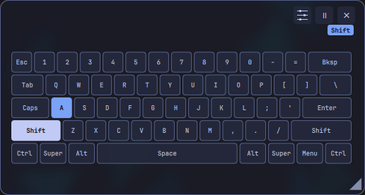
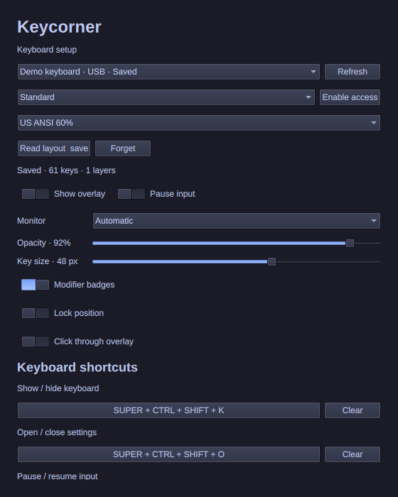
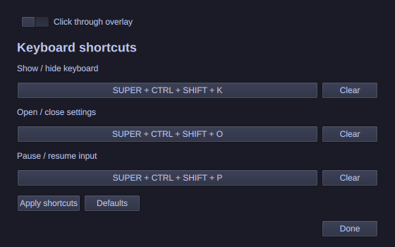

# Keycorner feature tour

Keep a keyboard reference in the corner of your screen and see which keys and modifiers are active. Keycorner runs inside Omarchy's shell and follows its theme.

## See keys and modifiers

Keys highlight as you press them and clear when released. Modifier badges make held Shift, Ctrl, Alt and Super visible. The example shows simulated Shift+A on a standard 60% layout. Vial mode can also highlight mouse-button output and infer unambiguous modifier-hold assignments.

## Choose a layout for each keyboard

Choose among 18 standard presets: US full-size/TKL/60%, Brazilian ABNT2, and full-size/TKL variants for UK, German, French, Spanish, Latin American Spanish, Italian and Portuguese layouts. The [catalog](../STANDARD_LAYOUTS.md) states each preset's validation level.

Compatible Vial keyboards provide their own layouts and keymaps. These are discovered from the user's device; Keycorner does not ship personal keyboard profiles. Missing permissions are handled through an explicit, device-specific access setup.

## Place it where it helps

Drag and resize the floating keyboard, then adjust its opacity and key size. **Lock position** disables the overlay's own drag and resize controls. **Click through overlay** sends pointer input to the window underneath; keyboard capture continues. Use the settings shortcut or bar button to regain control. Position and resized dimensions are session-only; appearance preferences persist.

## Pause without losing your reference

Pause input while leaving the layout visible, or use a separate shortcut to hide and pause together. Hiding, minimizing and screen locking stop the reader. Show/hide, settings and pause shortcuts can be recorded directly in Settings.

Keycorner cannot identify password fields. Pause before sensitive typing. It stores no typing logs and sends no key activity over the network.

## Follow Vial layers

Preview available layers manually. With the optional Keycorner firmware extension, the overlay follows exact live layer transitions and transparent-key fallthrough. Without it, manual previews and conservative suggestions remain available. Installing the plugin never flashes firmware; firmware compatibility and recovery must be handled separately.

## Screenshot provenance

These are screenshots of Keycorner's actual QML components rendered in an isolated desktop with synthetic layout/state and a generic “Demo keyboard.” Input-device access was unavailable and capture was forced off. Shift+A is simulated. The palette is a representative dark theme; the installed app follows Omarchy's current palette. Settings captures show the upper section and the same panel scrolled down. No personal layout, device identifier, typing log or user desktop appears in the images. The screenshots illustrate appearance, not additional hardware validation.
