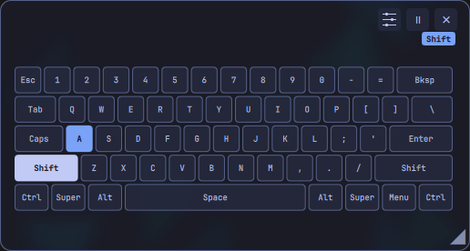

# Marketplace listing

See [publication status](../PUBLISHING.md#publication-status).

- Name: Keycorner
- Repository: https://github.com/lbiasuz/keycorner
- Category: System
- Tags: keyboard, overlay, vial
- License: MIT (optional firmware sources separately GPL-2.0-or-later)
- Preview: [preview.png](preview.png)
- Summary: A floating keyboard overlay for Omarchy with live key highlights, 18 standard layouts, Vial discovery and configurable privacy shortcuts.

## Description

A movable, translucent keyboard overlay for Omarchy. See pressed keys, mouse buttons and held modifiers, customize shortcuts, lock its position or enable click-through. Capture stops while hidden, paused or screen-locked.

Choose 18 US ANSI, Brazilian ABNT2 and regional ISO keyboard presets or discover layouts from compatible Vial keyboards. Save settings per keyboard. Exact live layers are available with the optional Keycorner firmware extension; installing the plugin never flashes firmware.

## Feature highlights



- Move, resize and adjust transparency; lock the position or enable click-through.
- Select from 18 standard layouts or discover a compatible Vial keyboard’s personal layout.
- See held modifiers and key activity; follow exact layers with optional firmware support.
- Record shortcuts for show/hide, Settings and pause without hiding.
- Match Omarchy’s theme and access the overlay from its bar button.

[See the feature tour and settings screenshots](FEATURES.md).

## Installation and requirements

On supported x86_64 Omarchy installations:

```sh
omarchy plugin add https://github.com/lbiasuz/keycorner --enable --yes
```

The Git checkout bundles the native executable; Cargo, Python and Vial Desktop are not required at runtime. Requires Omarchy's Quickshell/Hyprland environment and system libc (glibc 2.39+), libgcc_s and liblzma.

Open Keycorner Settings, select a keyboard when needed, and explicitly enable device access. Standard keyboards require a layout preset. A single compatible Vial candidate can be inspected automatically once access is available; multiple candidates require selection.

## Compatibility and privacy

Standard presets cover US ANSI, Brazilian ABNT2 and seven regional ISO arrangements; most have automated validation only. Vial support is capability-based, not a guarantee for every firmware or layout. Rotated layouts and some report fields are unsupported. Moving a device between USB ports may require selection again. Ordinary HID output cannot uniquely identify every physical switch when assignments overlap.

Input access is device-scoped and user-approved. The plugin runs inside Omarchy's unsandboxed shell. It does not transmit typing or download executable code at startup. Password-field detection is not provided; use the independent pause shortcut when needed.

## Removal

```sh
omarchy plugin disable lbiasuz.keycorner
omarchy plugin remove lbiasuz.keycorner --yes
```

Removal preserves preferences and desktop shortcut/rule files. Explicitly granted device permissions also remain until revoked. Follow the repository's access and uninstall instructions for full cleanup.

## Preview provenance

The screenshots render production QML components with synthetic ANSI 60% data and simulated Shift+A in an isolated desktop without input device access. Settings use a generic Demo keyboard and a representative dark palette. These are demonstrations, not recordings of someone’s typing. See [screenshot provenance](FEATURES.md#screenshot-provenance).

Submission checklist: [READINESS.md](READINESS.md). Marketplace process: https://plugins.omarchy.org/publish.html
